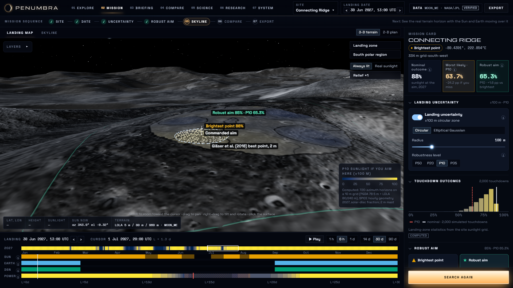
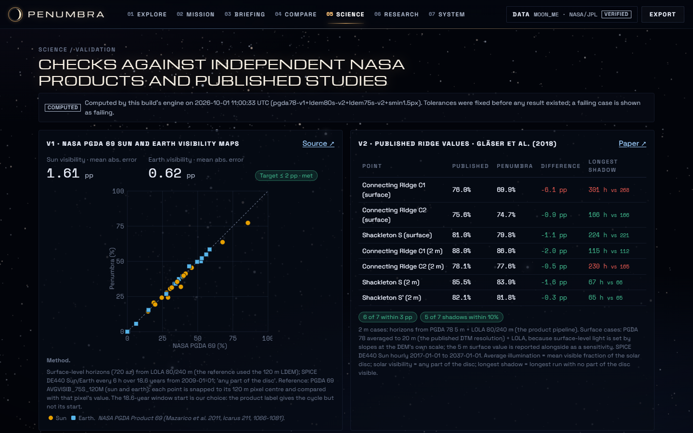

# Penumbra

**Know your odds of light before you land.** Penumbra is a lunar landing-planning tool for the south pole. It is a NASA Space Apps 2026 project (Challenge 4).

> Do not plan only for where you aim. Plan for where you may actually land.
> The brightest landing point is not necessarily the safest point to aim for.

Penumbra traces the real terrain skyline from NASA 5 m and LOLA elevation data, and takes Sun, Earth and DSN geometry from local JPL SPICE kernels. It simulates 2,000 possible touchdowns inside your landing ellipse. It then finds the **robust aim**: the aim point whose bad-case outcome (P10) is best, rather than the point that is brightest only if you land exactly on target.

| Planner: brightest point vs robust aim | Science & validation |
|---|---|
|  |  |

## What it does

- **3-D Moon** with LROC WAC/NAC and Kaguya imagery, down to 4 m/px at the poles. It has "Always lit" and real-sunlight lighting, and you can click any area for Sun and Earth conditions.
- **Five south-pole sites** on NASA PGDA 78 5 m terrain:
  - Connecting Ridge;
  - Shackleton rim;
  - Malapert;
  - Mons Mouton / Leibnitz β;
  - Nobile rim 1.
- **Terrain-aware sunlight and Earth visibility.** Horizons use 720 azimuths and reach 300 km. Partial solar discs are counted, and the Earth safety margin is user-set.
- **Landing uncertainty.** Circular or elliptical Gaussian models, 2,000 touchdowns, and P50, P20, P10 and P05 outcomes.
- **Find robust aim.** It searches every candidate aim and shows it beside the brightest point.
- **Mission calendar** with Sun, Earth, DSN and power bands. Dragging the landing date updates everything.
- **DSN geometric visibility** at Goldstone, Madrid and Canberra, with the caveat that it does not guarantee scheduled service.
- **Power scenario.** A VIPER preset built from NASA values, plus assumption-labelled presets.
- **Skyline dome and panorama, site comparison (2–5 sites), Simple and Planner modes.**
- **Validation and provenance in the app, JSON export, URL permalinks, and offline operation.**

## Quick start (Windows, macOS, Linux)

```bash
# 1. Python 3.12 environment
python -m venv .venv && .venv/Scripts/activate        # macOS/Linux: source .venv/bin/activate
pip install -r backend/requirements.txt               # offline: pip install --no-index --find-links ../penumbra_prep/env/wheelhouse -r backend/requirements.txt
# 2. Frontend dependencies
npm ci                                                 # offline: npm ci --prefer-offline
# 3. Data (not in the repository; see DATA_DOWNLOAD_MANUAL.md)
python tasks.py data                                   # download + verify the raw NASA/JPL files (3.3 GB) into data/raw/
python tasks.py precompute                             # horizon grids for the 5 sites, about 5 minutes on 16 threads
python tasks.py imagery                                # globe imagery tiles (downloads from USGS and NASA Moon Trek)
# 4. Check and run
python tasks.py doctor
python tasks.py dev                                    # http://127.0.0.1:4173
```

Permalinks open straight on a view, for example `http://127.0.0.1:4173/?mode=planner&site=cr1`, `?mode=simple&site=shk` or `?mode=planner&view=compare`.

## Assistant

The **Ask** button in the header opens **Armstrong**, Penumbra's assistant. How it works and everything it can do:
[ASSISTANT.md](ASSISTANT.md). It runs in one of two modes:

- **Built-in guide (default, free, works offline, no AI).** **Armstrong**, a guide written for non-specialists:
  - on a first visit, offers a short tour from a small bubble next to **Ask** (shown once);
  - greets you with what you're looking at and suggests a first move;
  - **What's this?**: tap it, then tap anything on screen (a number, the calendar, the map, a button) to have it
    explained in plain words with your numbers;
  - technical words in answers (P10, robust aim, DSN, landing zone…) can be tapped for a plain explanation, short
    answers come with **Tell me more**, and every answer can be **read aloud** (the browser's built-in voice);
  - a **Your plan** strip shows your site, date, accuracy and caution level, how many steps are done, and
    **Continue**;
  - every change it makes for you can be **undone** with one click;
  - **walks you through** planning a landing (site, date, landing accuracy, safer target, skyline, compare, export)
    with a progress bar, moving on by itself when you finish a step;
  - **explains every choice in plain words** as you make it, using your own numbers (how many of your first days
    get sunshine, when the first night comes, how long the battery lasts) and suggests the next step (switch off
    with **Tips off**);
  - **shows you where** controls are by highlighting them on screen;
  - **helps you decide**: "Help me choose a site" and "Help me pick a landing date" ask two or three quick questions
    (what matters most, how precise your lander is, how careful to be), then recommend with reasons and trade-offs;
  - understands typed requests and follow-ups, e.g. "switch to Shackleton", "what if I land on 15 July?",
    "set accuracy to 400 m", "and Malapert?", "yes" / "no" / "show me";
  - answers lead with an **In short** verdict; every number comes from Penumbra's own computations.

  Suggested changes appear as cards with a **Do it for me** button; nothing changes until you click. Code:
  `src/features/assistant/guide/` (`engine.ts` answers, `plain.ts` plain-language explanations, `nlu.ts` typed text,
  `watch.ts` tips, `spotlight.ts` highlighting).
- **AI assistant (when the server has a Claude API key).** Answers any question in natural language, as described
  below. It switches on automatically when `ANTHROPIC_API_KEY` is set; otherwise the built-in guide is used.

The AI assistant explains how to use the app, helps with choices (site, date, landing uncertainty, robustness level,
aim) and explains results in plain language. Each
question carries a snapshot of the current screen and the numbers the backend has already computed; the assistant
is instructed never to state a mission number that does not come from that snapshot or from its analysis tools.

- **Analysis tools.** For "what if" questions (another date, site, aim, landing accuracy, robustness level, vehicle),
  comparisons and best landing dates, the assistant calls tools that run the same science code as the API
  (`backend/app/assistant/tools.py`). The panel shows what is being computed and lists it under the answer.
- **Proposed changes.** When asked to set something up, the assistant proposes a change as a card listing exactly
  what will change. Nothing changes until you click **Apply**; it can guide you through the mission sequence one
  step at a time.

- Set `ANTHROPIC_API_KEY` in the environment or in `.env` (git-ignored) and restart the server.
- Model and effort: `PENUMBRA_ASSISTANT_MODEL` (default `claude-opus-5-5`), `PENUMBRA_ASSISTANT_EFFORT` (default `medium`).
- It needs the Claude API, so it is off when `PENUMBRA_OFFLINE=1`; `PENUMBRA_ASSISTANT=0` switches it off. When it is
  off, the panel says why instead of failing.
- Code: `backend/app/assistant/` (system prompt in `guide.py`), `src/features/assistant/`.

## Tests

```bash
python tasks.py test           # scientific + API (pytest) + frontend (vitest)
python tasks.py test --e2e     # + Playwright journeys A-C and responsive checks (server must be running)
python scripts/benchmark.py    # timings -> docs/performance.json
python scripts/gen_docs.py     # regenerate TEST_REPORT / PERFORMANCE / VALIDATION_RESULTS / DATA_PROVENANCE
```

Last run: 54 / 54 passed. See [docs/TEST_REPORT.md](docs/TEST_REPORT.md).

## Offline mode

Everything the judged flow needs is local: terrain, SPICE kernels, cached products, validation references and fonts.

- `PENUMBRA_OFFLINE=1 python tasks.py dev` forbids every outbound request. The globe then serves only imagery tiles already cached under `tiles/`.
- The end-to-end tests also fail if the browser requests anything that is not on the local machine.
- Offline run on 2026-10-01: PASS.

## NASA / JPL data

| Data | Use |
|---|---|
| NASA PGDA Product 78: 5 m south-pole DEMs, slope, error, 20 error clones (Barker et al. 2021) | Near-site terrain and the 3-D view |
| NASA LRO LOLA LDEM_80S_80M and LDEM_75S_240M (PDS) | Horizons to 150 km and 300 km |
| NASA PGDA Product 69: average Sun and Earth visibility (Mazarico et al. 2011) | Validation V1 |
| NAIF SPICE: DE440, MOON_ME (DE440/ME421), DSN station and topocentric kernels, Earth orientation | Sun, Earth and DSN geometry |
| JPL Horizons tables | Validation V4 |
| DSN 810-005 module 301 Rev. P | Elevation masks (6° and 10.1°) |
| Gläser et al. (2018), Planetary and Space Science 162 | Validation V2 |
| LROC WAC/NAC mosaics (USGS Astrogeology, NASA Moon Trek), Kaguya TC (JAXA), Chang'e-2 hillshade | Globe imagery only |

The data is not stored in this repository. `python tasks.py data` downloads every file from its source and checks it against recorded checksums; see [DATA_DOWNLOAD_MANUAL.md](DATA_DOWNLOAD_MANUAL.md). Files, versions, frames and checksums are in [docs/DATA_PROVENANCE.md](docs/DATA_PROVENANCE.md).

## Validation (tolerances fixed in advance)

| Case | Result | Tolerance | Status |
|---|---|---|---|
| V1: NASA PGDA 69 maps, 17 points | MAE 1.61 pp (Sun), 0.62 pp (Earth) | ≤ 2 pp | PASS |
| V2: Gläser et al. 2018, 7 published points | 6 / 7 within 3 pp | ≥ 5 of 7 | PASS |
| V4: SPICE vs JPL Horizons | max 0.1″ | ≤ 10″ | PASS |

Method, equations and limitations are in [docs/SCIENTIFIC_VALIDATION.md](docs/SCIENTIFIC_VALIDATION.md); per-point tables are in [docs/VALIDATION_RESULTS.md](docs/VALIDATION_RESULTS.md).

## Architecture

```text
Browser (React + TypeScript, Vite build in dist/)
   │  /api/*  JSON                    /tiles/*  imagery (built on demand, cached)
   ▼
FastAPI  backend/app/main.py  ── services: sites · products (cache) · bundle · analysis · validation · provenance
   │
   ▼
science/  coordinates · terrain · horizon (Numba) · ephemeris (SPICE) · visibility · landing (robust aim) · dsn · power · validation
   │
   ▼
data/raw (NASA/JPL files, SHA-256) → data/cache (.npz/.json keyed by inputs)
```

Details are in [ARCHITECTURE.md](ARCHITECTURE.md). Coordinates and frames are in [docs/COORDINATE_SYSTEMS.md](docs/COORDINATE_SYSTEMS.md). Timings are in [docs/PERFORMANCE.md](docs/PERFORMANCE.md).

## Limitations

- **Terrain.** Resolution and elevation uncertainty affect results. PGDA 78 5 m grids are partly interpolated, and surface-level light on knife-edge ridges depends on DEM resolution.
- **Landing model.** A user-selected uncertainty model is not the true distribution of a real lander.
- **DSN.** Geometric visibility is not scheduled service.
- **Power.** The energy model is not a thermal or electrical mission simulation, and non-VIPER presets are assumptions.
- **Grid.** Grids are computed for a 2 m mast and 2027 by default. Other years and masts are computed on request.


## Citations

- Barker, M. K., et al. (2021). Improved LOLA elevation maps for south pole landing sites: error estimates and their impact on illumination conditions. *Planetary and Space Science* 203, 105119.
- Mazarico, E., et al. (2011). Illumination conditions of the lunar polar regions using LOLA topography. *Icarus* 211(2), 1066–1081.
- Gläser, P., et al. (2018). Illumination conditions at the lunar poles: implications for future exploration. *Planetary and Space Science* 162, 170–178.
- Acton, C. H. (1996). Ancillary data services of NASA's Navigation and Ancillary Information Facility. *Planetary and Space Science* 44(1), 65–70 (SPICE).
- NASA DSN Telecommunications Link Design Handbook 810-005, module 301 Rev. P.
